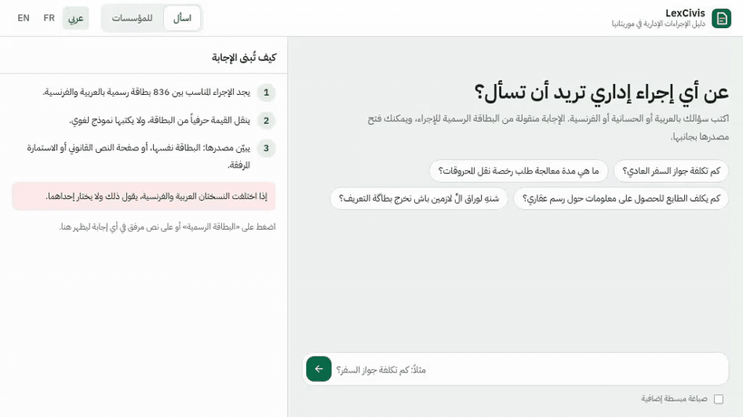

# LexCivis

**Answers about Mauritania's administrative procedures, copied from the official records, with the source beside every
answer.**

<p align="center"><a href="docs/demo.mp4"></a></p>
<p align="center"><a href="docs/demo.mp4">Full demo video, 2 minutes</a></p>

LexCivis answers citizens' questions about administrative procedures in Arabic, Hassaniya and French. The interface is
in Arabic, French and English.
- Every answer is the **official value, copied word for word** from the procedure's record. Its source opens beside the
  answer: the record with the cited field highlighted, or the page of the decree or form attached to the procedure.
- When the Arabic and French records disagree, it **shows both and holds the answer** instead of picking one.
- Around the assistant, five institutional agents run a staged error exercise. A mandate guard and legal-order rules
  decide what their proposals may do, and a human gate holds every action with public or legal effect.
- Every step goes into a SHA-256 hash-chained ledger, signed with Ed25519.

LexCivis is the public-services layer of **LexMR**, our larger project: a verified, provenance-tracked corpus of
Mauritanian law built from the Journal Officiel and the legal codes (2,499 PDFs, 90,962 pages, French 1959–2026 and
Arabic 1989–2026). See [Part of LexMR](#part-of-lexmr).

## Why not a fine-tuned chatbot
Fees, delays and document lists are facts. A model trained to remember them would sooner or later produce a
plausible wrong amount. LexCivis keeps the facts in the data and gives each model a narrow, testable job.

| Step | Component | What it does |
|---|---|---|
| 1 | Field classifier: TF-IDF char/word n-grams + logistic regression, **trained on this data** | Finds which field is asked: documents, fee, delay, office, legal basis… |
| 2 | Hybrid search: BM25 + BGE-M3 dense vectors, reciprocal-rank fusion, BGE-reranker-v2-m3 | Ranks procedures by topic, across languages. Amounts in the question are removed from the search text |
| 3 | Field verification: the reranker reads the asked field in the top 3 procedures | Gates refusal (below a calibrated score). Lets a lower-ranked record win only when its field supports the question at least 5 times better. Asks to clarify vague questions |
| 4 | Answer composer (deterministic) | Copies the official value and shows source and date. Holds French/Arabic conflicts and misfiled fields. Checks any amount quoted in the question against the record |
| 5 | Optional LLM | Plain-language rephrasing only. Rejected if it adds or drops a number, or if under 75% of its wording comes from the record. The official card stays on screen |

The thresholds and quality targets are not hard-coded: they live in the ITU-T Y.3172 **ML intent**
(`src/lexcivis/governance/resources/ml_intent.yaml`), and `lexcivis evaluate` checks the results against it.

## Knowledge base
- `data/procedures.json`: 836 procedures, one record per language (812 French/Arabic pairs). Web links were removed
  from the records; every citation points to a place in this file (entry, language version, record id, field).
- `data/documents/`: the legal texts and forms attached to the procedures (`lexcivis library <folder>` rebuilds it).
  - 106 procedures attach 242 files. They are **98 distinct documents** (55 legal texts, 43 forms, 1,630 pages), stored
    once each under their SHA-256, with every original file name kept in `manifest.json`.
  - Word forms are converted to PDF for display. Every page has its text in `pages/`: from the PDF text layer, or
    from Tesseract OCR (French + Arabic) for the **200 scanned pages** that had none.
  - An answer lists the texts attached to its procedure and the laws its legal-basis field cites (matched by number),
    each opened at the page that best matches the question.
- `src/lexcivis/governance/resources/law_2017_020.json`: Law 2017-020 on personal data protection, 101 articles.

## What the data shows
Measured on all procedures (`lexcivis quality`, `lexcivis profile`, `data/DATA_CARD.md`):
- **54 procedures (6.7%) give a different fee or delay in French and in Arabic.**
  - 94 automatic flags, each reviewed by reading both texts: 63 confirmed, 28 false alarms, and 3 fields filled in
    the wrong place ("misfiled").
  - Verdicts and reasons are in `data/quality/verdicts.json`.
  - Typical case: the land-title stamp is 50 MRU in the French record and 20 new ouguiya in the Arabic record.
- **279 pairs (34%)** cite no legal basis in either language.
- 11 procedures are published twice, and 104 of 13,160 related-procedure links point to records that do not exist.
- Fees:
  - 327 free, 193 with an amount (median 2,000 MRU), 158 empty, 64 "non spécifié".
  - 190 pairs list a different number of documents in French and in Arabic.
- Delays: 507 real durations; 158 are not a duration at all ("à la demande", "relatif").
- 506 procedures give only a generic ministry e-mail as contact.
- Completeness ranges from 47% to 100% across the 31 administrations.
- Records carry a last-update date (2023: 527, 2024: 190, 2025: 119) but no validity period.
- Attachments: 141 of the 242 files are copies of another one, 3 are macOS metadata files instead of the PDF, 28 documents
  are scans without text, and 2 are titled with a phone-scanner file name ("CamScanner …"), one on 16 procedures.

## Results
`lexcivis evaluate` and `lexcivis benchmark` (CPU only; `reports/`):

| Set | n | Right procedure first | Right field | Both right | Refused |
|---|---|---|---|---|---|
| **Locked benchmark v2** (FR 100, AR 100; 95% bootstrap interval) | 200 | 89% (84–93) | 96% (94–99) | 86% (80–91) | 2 |
| SANAD procedure questions (FR 30, AR 20) | 50 | 82% (top 3: 98%) | – | – | 0 |
| Hand-written field questions (FR 30, AR 15, Hassaniya 10) | 55 | 84% | 95% | 78% | 2 |
| Must refuse (calibration) | 10 | – | – | – | 10/10 |
| Must refuse, held out | 20 | – | – | – | 19/20 |

How to read it:
- **Locked benchmark v2:** 200 questions generated from the records with new wording. They were written and hashed
  (`reports/benchmark_v2_lock.sha256`) before any tuning and run at the end. They were run once more after the
  web links were removed from the data. 3 of 200 answers changed (90% → 89% right procedure, 87% → 86% both right):
  two are exact ties between procedures that share the same Arabic title (e.g. تعيين الموثقين is the Arabic title of
  both "Désignation de Notaires" and "Désignation des Mouslihs"), and the third was wrong both times.
- **Development benchmark v1:** its first run, before tuning, gave 84% right procedure, 80% right field and 68% both right. Its weak spots (Arabic delay
  questions, French "where do I file") were then used to enrich the training patterns. That run is kept as
  `reports/benchmark_v1_dev_before_tuning.json`.
- **Refusal threshold:** calibrated on the SANAD set, the 55 hand-written questions and the first must-refuse set
  (`reports/calibration_support.json`). The 20-question must-refuse set was held out.
- Two retrieval ideas were tested and rejected on evidence (`reports/ab_topic_rerank.md`).
- ML-intent targets: procedures_50.recall@3 0.98 vs goal 0.95 (met); field_questions_55.field 0.945 vs goal 0.9 (met); must_refuse_10.refused 1.0 vs goal 1.0 (met); must_refuse_holdout_20.refused 0.95 vs goal 0.9 (met); benchmark_v2.end_to_end 0.86 vs goal 0.7 (met).

**Staged exercise, same nine citizen questions:**

| | SANAD v1 (baseline RAG, `examples/baseline_sanad_v1/`) | LexCivis (`examples/runs/`) |
|---|---|---|
| Answered with the official value | 3 of 9 (one gave a single value on a French/Arabic conflict) | 5 of 9 |
| Held on a French/Arabic conflict | 0 | 3 |
| Refused | 6 | 1 (with a warning on the quoted amount where there is one) |
| Asked to clarify | – | 0 |

## Quick start
```bash
python -m venv .venv && . .venv/bin/activate
pip install -e ".[dev]"
lexcivis serve --port 8080
lexcivis library /path/to/attachments   # only to rebuild data/documents (needs LibreOffice and Tesseract fra+ara)
```
Open http://127.0.0.1:8080 (Arabic, French or English, picked from the browser; `?lang=ar|fr|en` forces one). **Ask** puts
the official record or the page of the attached law beside each answer; **For institutions** shows the data findings,
the governance exercise and the gap register. The first start downloads
BGE-M3 and the reranker (about 4.5 GB). The prebuilt index and classifier are in `artifacts/`.

```bash
lexcivis ask "Combien coûte le renouvellement du permis de conduire ?"
lexcivis ask "گداش تجديد رخصة السياقة؟"
lexcivis quality && lexcivis profile
lexcivis evaluate && lexcivis benchmark
lexcivis keygen                     # authority signing key (outside the repository) + public key in keys/
lexcivis exercise [--llm]
lexcivis exercise --stages S1 --inject "La police demande les journaux sans réquisition" --inject-question "..."
lexcivis approve <run> <seq> <action> --by "Name" [--decision reject]
lexcivis verify runs/<run>/ledger.jsonl
pytest
```
Docker: `docker build -t lexcivis . && docker run -p 8080:8080 lexcivis`.

LLM agents and plain-language rephrasing are optional:
- Use any OpenAI-compatible endpoint with `LEXCIVIS_LLM_API_KEY`, or `LEXCIVIS_LLM_BACKEND=module:function`.
- Without an LLM, the agents follow the written playbook, and the whole exercise is reproducible offline.
- The example LLM run used `openai/gpt-oss-120b` on Groq, recorded in each decision's `llm.model` with the
  prompt's SHA-256 and the raw output.

For public hosting:
- Set `LEXCIVIS_TOKEN`. LLM features and human decisions then need the `X-LexCivis-Token` header.
- Asks and exercises are rate-limited, and model calls go through a bounded worker pool.
- Each question is logged with personal data masked (ID numbers, phones, e-mails, dates, self-declared names) in
  `runs/ask/ledger.jsonl`.

## The governance exercise
| Stage | Situation | Controls |
|---|---|---|
| S1 | Launch: passport and ID-card questions in French and Arabic | Cited official values |
| S2 | Land-title stamp: 50 MRU (French record) vs 20 new ouguiya (Arabic record), real data | Answer held in both languages; the procedure owner confirms |
| S3 | SIMULATED: a new delay is announced; the 2023 record did not change, and French/Arabic also disagree | Date shown, value held, record update requested |
| S4 | Hassaniya questions, Arabic and Latin script | Dialect expansion; refusal if nothing matches |
| S5 | SIMULATED: ID and phone numbers in a question; the UAE host asks to train on the logs; a vendor wants a copy abroad | Masking before search and ledger. Training BLOCKED (outside the host's mandate, art. 11). Transfer BLOCKED until the operator has informed the authority **and** the authority's conditions are approved by a human (rule R1, arts. 20-22) |
| S6 | SIMULATED: a fake SMS announces a 5,000 MRU ID-card fee | The amount is checked against the official record and the citizen is warned. Cyber incident and takedown proposals; no "rule change" is published |
| S7 | Any event typed live (fraud, third-party data requests, outages, rule changes…) | All five agents |

The five agents are: service operator, procedure owner, data-protection authority (created by law 2017-020
art. 64; powers in arts. 76, 77, 79), national cyber-incident team, and the hosting provider in the UAE.

Where things live:
- Mandates, the legal-order rules R1/R1b, the human gate R3 and the legal slices are in `agents.yaml`.
- The offline playbook is in `playbook.yaml`.

How the guard works:
- A proposal waiting for a human never counts as done. Only an allowed action can satisfy a legal-order rule.
- Citations of Law 2017-020 articles (including ranges such as "arts. 20-22") are checked against each agent's
  legal slice. Citations outside the slice are flagged in the decision and the case brief, never silently accepted.

What the ledger records:
- `run_start` holds the provenance: SHA-256 of the data, the verdicts and the classifier; the index fingerprint; the
  models; the policy taken from the ML intent.
- Each LLM decision stores the model, the prompt hash and the raw output.
- Human decisions are chained in the same ledger, and the head is re-signed after each one.

How sealing works:
- At the end of each run, the ledger head is signed with an Ed25519 key held outside the repository (in a real
  deployment, by the data-protection authority).
- `lexcivis verify` checks the chain **and** the signature against `keys/authority_ed25519.pub`.
- A rewritten chain, even with every hash recomputed, fails the signature check
  (`tests/test_governance.py::test_seal_detects_a_rewritten_chain`).

## Standards alignment
- **ITU-T Y.3172:** the node map is in the web interface. The ML intent (`ml_intent.yaml`) is the declarative input
  that configures the pipeline and its quality targets, and `lexcivis evaluate` closes the loop by reporting each
  target as met or missed.
- **ITU AI Readiness 2.0:** a self-assessment against the 13 dimensions and their metrics is in
  `reports/readiness_assessment.md`. The gap register maps each gap to dimensions.
- **National strategy:** Mauritania's National AI Strategy 2025-2029 (final version, 26 July 2024), objectives
  4.4.1, 4.6.1, 4.6.2 and 4.8.4 (Hassaniya translation).

## Repository
| Path | Content |
|---|---|
| `src/lexcivis/` | catalog, text normalisation, Hassaniya lexicon and citizen-wording map, search, intent model, answer composer, privacy, profile, benchmark, LLM adapter, API, CLI |
| `src/lexcivis/governance/` | agents, guard, ledger, Ed25519 seal, exercise, case brief; YAML mandates, playbook, stages, gaps, ML intent; law 2017-020 (101 articles) |
| `data/` | `procedures.json` (web links removed, values unchanged), `documents/` (98 legal texts and forms, page text, manifest), `DATA_CARD.md`, `derived/` (normalised records, profile), `quality/verdicts.json`, `eval/` (all question sets) |
| `artifacts/` | dense index (1,648 records × 1,024, float16) and the trained intent model |
| `reports/` | evaluation, benchmarks, calibrations, rejected experiments, Readiness 2.0 self-assessment |
| `examples/` | sealed runs (rule playbook and LLM agents) and the SANAD v1 baseline |
| `keys/` | public key of the sandbox signing authority |
| `web/` | the interface: Arabic first, French and English; answer and evidence side by side; document viewer; light and dark |
| `docs/` | demo video and its preview |

## Part of LexMR
LexCivis works today on the procedure records and the 98 texts they attach. LexMR is the next knowledge base:
- the Journal Officiel and the legal codes, 2,499 PDFs and 90,962 pages, French 1959–2026 and Arabic 1989–2026;
- every unique page measured and given a quality tier; acts, numbers and dates are being checked between the French and Arabic
  editions;
- the data for a Mauritanian legal model, and for answers that cite the exact issue and article of the Journal Officiel.

The governance layer stays the same when the knowledge base grows: cite or refuse, hold on disagreement, mandates,
human gate and signed ledger.

## Limits
- **Hassaniya:**
  - The lexicon and the citizen-wording map are seed lists written by the team.
  - The 10 Hassaniya test questions cover 5 procedures.
  - A native-reviewed set over many procedures is the next step.
- **Retrieval:**
  - Wrong-but-cited answers remain possible.
  - The locked benchmark gives the rate. Clarification and field verification reduce it but do not remove it.
  - Vague questions that match a procedure's title word for word (e.g. "aide") can still get that procedure.
- **Agents:**
  - Signals are keyword-based, apart from claimed amounts, which are compared by number.
  - LLM agents may still misread an event. The guard decides what is allowed, not the model.
- **Ledger seal:** the sandbox key is local. A real deployment would keep it with the authority or anchor the head
  with an RFC 3161 timestamp.
- **Scenarios and legal readings:** facts marked SIMULATED are invented. Legal readings are for expert review.
- **Conflicts:** the tool shows that the French and Arabic values differ. It cannot say which one is right.

Data: `data/procedures.json` and `data/documents/` (Mauritania's public administrative procedures and their attached
texts). Law 2017-020: Journal Officiel de la République Islamique de Mauritanie
n°1400, 15 November 2017.
